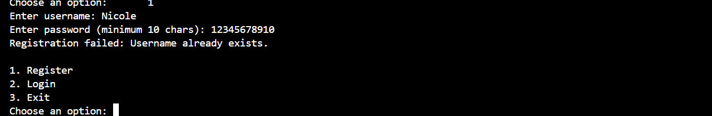

# Secure Banking Application

Secure Banking Application is a console-based Java project developed to demonstrate object-oriented programming, secure coding practices, and file-based persistence. The application allows users to register, log in, create bank accounts, deposit and withdraw funds, and view transaction history while keeping all data stored in text files.

## Project Objective

The primary goal of this project is to design and implement a secure banking system in Java that follows core OOP principles, validates user input, protects sensitive data, and persists application data into local files without using a database.

## Features Implemented

- User registration and login system
- Password hashing using PBKDF2 with HMAC-SHA256
- Password salt generation for secure storage
- Account creation for registered users
- Balance checking for each account
- Deposit and withdrawal operations with validation
- Maximum transaction and balance checks
- Transaction history tracking
- Persistent storage using text files for users, accounts, and transactions
- Input validation for alphabetic-only usernames, passwords, and financial values
- Secure configuration constants for application rules

## Technologies Used

- Java 17
- Maven
- JUnit 5
- File-based storage using plain text files

## Project Structure

- src/main/java/com/securebank/Main.java – application entry point and console menu
- src/main/java/com/securebank/service/BankingService.java – core business logic and persistence management
- src/main/java/com/securebank/model/User.java – user entity model
- src/main/java/com/securebank/model/BankAccount.java – account model and balance operations
- src/main/java/com/securebank/model/Transaction.java – transaction record model
- src/main/java/com/securebank/config/AppConfig.java – constants and security configuration
- src/test/java/com/securebank/service/BankingServiceTest.java – automated tests for banking logic

## How to Run

1. Open a terminal in the project root.
2. Run the test suite:

```bash
mvn test
```

3. Start the application:

```bash
mvn clean package
java -jar target\securebankapp-1.0.0.jar
```

## Application Flow

When the application starts, the user is presented with a menu to:

- register a new user
- log in as an existing user
- exit the program

After login, the user can:

- create a new bank account
- view account balances
- deposit funds
- withdraw funds
- review transaction history
- log out

## Screenshot Evidence

Screenshots are included for the successful build, registration, login, logout, a rejected withdrawal, and the generic message check.

- Build: 
- Registration: 
- Login: 
- Successful login: 
- Logout: 
- Failed withdrawal: 
- Generic message check: 

## Data Persistence

The application stores data in text files within the project data directory:

- users.txt
- accounts.txt
- transactions.txt

This ensures the application retains user credentials, account details, and transaction records between runs without requiring a database.

## Security Notes

- Passwords are never stored in plaintext.
- Each password is hashed using a random salt and PBKDF2.
- System limits prevent invalid financial values from being processed.
- Usernames must be 3–20 alphabetic characters; digits, whitespace, and punctuation are rejected.
- Passwords are validated before acceptance.

## Testing

The project includes automated tests to validate:

- minimum transaction rules
- consistent balance and limit checks
- deposit and withdrawal functionality
- password hashing and verification

## OOP Principles Demonstrated

- **Encapsulation:** `User`, `BankAccount`, and `Transaction` keep their fields private and expose values through getters. `BankAccount` changes its balance through `deposit()` and `withdraw()` rather than a public setter.
- **Composition:** `BankingService` holds `User`, `BankAccount`, and `Transaction` objects in its collections and coordinates their use; it does not inherit from these model classes.
- **Single Responsibility:** `Main` handles console interaction and coordinates service calls. `BankingService` contains the banking rules and file persistence operations. Each model class represents one domain concept.
- **Abstraction:** `BankingService` keeps PBKDF2 hashing, salt handling, and iteration details inside its private `hashPassword()` and `isValidPassword()` methods. Callers use registration and login methods without handling cryptographic details.
- **Inheritance and polymorphism:** These are not used by the project; they are not needed for its current scope.

## Security Analysis

Passwords are stored as PBKDF2 hashes with randomly generated salts rather than as plaintext. The implementation uses HMAC-SHA256, 210,000 iterations, a 16-byte salt, and a 256-bit hash. Per-password salts prevent reusable precomputed hashes, while the iteration count raises the cost of guessing; this slows offline cracking but cannot prevent it. The `passwordsAreHashedAndVerified` test checks stored hashes and salts and verifies login behavior, but does not benchmark cracking resistance.

`BankingService` checks account ownership before balance, deposit, withdrawal, and transaction-history operations. The supplied username must match the account owner's username. The `usersCannotAccessAnotherUsersAccount` test checks that each of these operations rejects access to another user's account.

Login applies an in-memory, per-username lockout after five failed attempts for five minutes. Further attempts are rejected during that period, and a successful login resets the counter. The `loginLocksUsernameAfterMaximumFailedAttempts` test checks the threshold; the reset behavior is not tested separately.

Deposit and withdrawal amounts use `BigDecimal` and must be positive and within the configured minimum and maximum limits. Invalid amounts are rejected before changing the balance, and malformed text is rejected during parsing. Tests cover zero and negative amounts, malformed deposit input, and an insufficient-funds withdrawal.

When loading `users.txt`, `accounts.txt`, or `transactions.txt`, malformed records are skipped with a warning. Loading fails after more than five malformed lines in a file. Warnings include the filename and line number, not the record contents. Tests cover skipping a malformed user record and exceeding the threshold in `users.txt`; the other data files are not tested separately.

Each data file is saved to a temporary file and then moved into place with `ATOMIC_MOVE`, where the filesystem supports it. This avoids replacing the target until the temporary file has been written, but does not protect a set of files as one transaction. Persistence is tested by reloading the service from the same directory; interrupted writes are not simulated.

Login and storage failures use generic messages, and malformed-record warnings omit record contents. Sensitive input and stored records are not included in those messages, although some account and validation errors remain specific. There is no dedicated error-message leakage test; this assessment is based on code inspection.

Monetary values use `BigDecimal`, and balances are rounded to two decimal places with `HALF_EVEN` to avoid binary floating-point errors. Inputs with extra decimal places are not explicitly rejected, however, so transaction records can retain more precision than rounded balances. Deposit and withdrawal tests check two-decimal balances with `BigDecimal.compareTo()`; higher-precision inputs are not tested.

This project does not encrypt account or transaction files at rest, and it cannot protect data from someone with direct access to the files. Atomic replacement applies to individual files only; there is no multi-process file locking or cross-file transaction covering both balances and transaction history. Error-message protection is also partial, as noted above.

## Known Limitations

- The application is a single-process console program without support for concurrent users or multiple application processes accessing the files safely.
- Account and transaction data are stored without encryption; local file access can expose or alter them.
- Password validation enforces length limits but has no additional complexity requirements.
- There is no email or phone verification, password recovery, or identity verification.
- Login lockout state is held in memory and resets when the application restarts.
- Login lockout is the only rate limiting; other operations have no rate limiter.
- Atomic writes protect individual files, not a complete update spanning account and transaction files.
- Transaction inputs with more than two decimal places are not explicitly rejected, so recorded transaction amounts can differ in scale from rounded account balances.

## Future Improvements

- Encrypt data files at rest and introduce secure key management.
- Replace text-file persistence with a database supporting concurrent access and transactions.
- Persist or centralize login lockout state so it survives restarts and is shared across processes.
- Add repository interfaces to make storage backends replaceable and easier to test.
- Add role-based access for administrative functions.
- Add tests for malformed account and transaction files, interrupted writes, and error-message disclosure.

## Conclusion

This project demonstrates a practical implementation of a secure banking application in Java, combining object-oriented design, validation, security controls, and persistent storage in a simple but effective console application.
